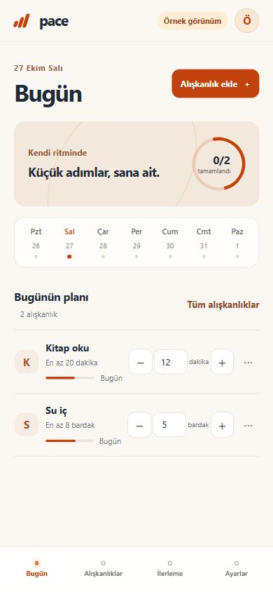

# PACE

[Open PACE](https://pace.ferhatgunes.com.tr) · [Try the demo](https://pace.ferhatgunes.com.tr/?demo=1)

**PACE** is a calm, mobile-first habit tracker. Build several routines, choose the days that fit your life, and keep progress tied to your account across devices.

> First release. It supports daily habits, selected weekdays, weekly quotas, check-in or quantity tracking, optional increasing targets, and optional carryover for unfinished minimum targets.

## What it does

- Track multiple habits with either a one-tap check-in or a numeric amount and unit.
- Choose every day, selected weekdays, or a number of sessions per week.
- Use fixed goals or increase numeric goals by a chosen step.
- Optionally carry an unfinished minimum goal to the next planned period.
- Keep account data in Cloudflare D1 and sign in with an email address and password.
- Install the website as a PWA; the app shell can open offline, while cloud saves clearly require a connection.
- Export your account data as JSON.

PACE uses supportive, neutral status labels. Unscheduled days do not count as missed days.

## Run the demo

The demo is intentionally local to the current browser and marked **Örnek görünüm**. It is not account-backed and should not be used for important records.

Open the deployed site with `?demo=1`, or run a static server from the repository root and visit `/?demo=1`.

## Cloudflare Pages setup

1. Create a Cloudflare Pages project from this GitHub repository.
2. Create a D1 database named `pace` and apply the SQL files in `migrations/` in order.
3. Bind that database to the Pages project using the binding name `DB`. Set the build command to `npm run build` and output directory to `dist`.
4. In Pages **Settings → Variables and Secrets**, configure a long random secret named `AUTH_SECRET`. Keep it stable: recovery code hashes depend on it.
5. Set the D1 database ID in `wrangler.toml` if using Wrangler for deployment or migration commands.
6. Deploy over HTTPS. Keep all secrets in Cloudflare; never put real credentials in this repository.

Accounts use a password of at least 10 characters. Passwords are salted and derived with PBKDF2-SHA256 (100,000 iterations). A one-time recovery code is shown after account creation; using it replaces the password and recovery code and revokes existing sessions. Email addresses serve as account identifiers and are not verified or used for marketing.

Sessions are stored as hashed random tokens and expire after 30 days. Requests are scoped to the signed-in account, mutating requests require the same origin, and authentication attempts are rate limited. If both the password and recovery code are lost, there is no automated account recovery in this release.

Email-code endpoints remain optional. To enable that delivery service, configure `RESEND_API_KEY` and a verified `EMAIL_FROM` sender. The default interface uses password accounts and requires neither setting.

### Local Pages preview

Run `npm run build` and use Wrangler with a local D1 database and a local `.dev.vars` file. Copy `.dev.vars.example` to `.dev.vars` with development-only values. Do not commit the copied file. Run `npm run check` for source syntax checks.

## Repository layout

- `index.html`, `assets/`: PACE interface and PWA assets.
- `functions/api/`: authenticated Pages API.
- `functions/lib/`: session, response, and request helpers.
- `migrations/`: D1 schema migrations.
- `design-system/pace/MASTER.md`: interface tokens and interaction rules.

## Security and privacy

Please report security concerns privately using GitHub's **Security → Advisories** flow. Do not open a public issue containing account data, credentials, or exploitable details. See [SECURITY.md](SECURITY.md).

## License

The repository is public. A reuse license has not yet been selected; until one is added, no additional reuse rights are granted. Choose a license before inviting external contributions or describing this as open-source software.

## Language

The product interface is currently Turkish. The code and setup notes are intended to remain approachable to contributors; translations can be added without changing the habit model.

## Preview

